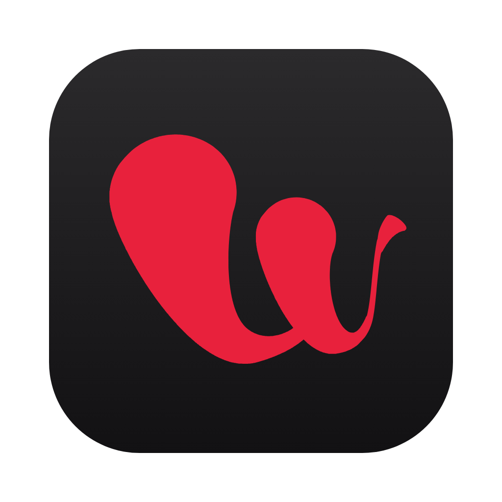

<div align="center">
  
  <h1>Wefty</h1>
  <p>A local library of your coding agents' sessions and memories —<br />and when one agent stops, pick the work up in another.</p>

  [](https://github.com/CodeStrate/Wefty/releases)
  [](https://www.electronjs.org)
  [](#stack)
  [](#privacy)
  [](https://github.com/CodeStrate/Wefty/stargazers)

  [](#download)
  [](#download)
  [](#download)
</div>

---

Wefty does three things:

1. **It's a library of everything your coding agents remember.** It reads the session transcripts, memory files, and project context files that harnesses like Claude Code and Codex already leave on disk, and puts them in one place — a timeline, a graph, and a searchable list, with a transcript reader and a memory editor.
2. **It keeps your work moving when an agent can't.** Hit a usage limit, or the provider is down? Open the session in Wefty and continue it in another agent. The handoff is built from the transcript that's already on disk — nothing to prepare in your project, no `HANDOFF.md` to keep up to date, no work-in-progress commit.
3. **It keeps everything in one window.** Wefty has a built-in terminal — the same stack VS Code uses (node-pty + xterm.js) — so you don't need a terminal open next to it. Open the terminal pane, resume or hand off a session, and keep vibing.

It isn't an agent and it isn't a sync service. It reads and writes **your local files**, runs your shell in its terminal, and does nothing else.

> **Alpha.** Builds are unsigned and Cursor, opencode, and Aider support is untested. Expect rough edges — [issues](https://github.com/CodeStrate/Wefty/issues) are very welcome.

[Download](#download) · [Features](#features) · [Harnesses](#supported-harnesses) · [Build from Source](#build-from-source) · [How It Works](#how-it-works) · [Privacy](#privacy) · [Stack](#stack) · [Development](#development) · [Contributing](#contributing) · [Roadmap](#roadmap)

## When Your Agent Stops Mid-Task

You're deep in a session and Claude Code hits its usage limit — or the provider has an outage. Normally you'd write up where you were, commit something half-done, and re-explain it all to the next agent.

With Wefty:

1. Open the session (it's already in the library — Wefty watches the agents' folders).
2. **⋯ → Continue in Codex** (or Claude Code, the other way round).
3. Wefty builds a Markdown handoff from the transcript — the original goal, open threads, the last turns, files touched, related memories — saves it in its own data folder, and starts the other agent in your project with *"Read this handoff and continue."*

Your repository is never touched: no handoff file, no commit, no branch. The same works for any session, not just interrupted ones — copy the handoff, or drop its path into any agent's prompt.

## vs Each Harness's Own History

Every harness can already list and resume its own sessions. Wefty is for the work that spans them — across projects, and across agents.

| | Harness CLI (`claude --resume`, `codex resume`, …) | Wefty |
|---|---|---|
| Browse sessions | One harness, one project at a time | All enabled harnesses and projects together |
| See work over time | No | Timeline: one lane per project |
| See what links to what | No | Graph: memories, the sessions that read or wrote them, and links between memories |
| Search transcripts | Varies | Across titles, prompts, paths, and projects; plus search inside a transcript |
| Edit memory and context files | By hand | Built-in editor with preview |
| Resume a session | Yes, in that harness | Yes — in a built-in terminal, in the session's own folder |
| Continue in a *different* harness | No | Yes — one click, built from the transcript (Claude Code ↔ Codex) |
| Prepare for a handoff | Write notes or commit WIP yourself | Nothing — the transcript on disk is enough |

## Download

Grab the latest build from [Releases](https://github.com/CodeStrate/Wefty/releases).

| OS | File | First launch (unsigned alpha) |
|---|---|---|
| macOS (Apple Silicon / Intel) | `.dmg` or `.zip` | If macOS says the app "is damaged", run `xattr -cr /Applications/Wefty.app`, then open it |
| Windows 10/11 | `.exe` installer | SmartScreen: **More info → Run anyway** |
| Ubuntu / Debian | `.deb` | `sudo apt install ./Wefty_*.deb` |
| Any Linux | `.AppImage` | `chmod +x Wefty-*.AppImage && ./Wefty-*.AppImage` |

The tour starts on first launch; replay it any time from **Help → Show Tour**.

## Features

| Feature | Description |
|---|---|
| Timeline | One lane per project, newest activity on top. Sessions are bars from first to last message, memories are diamonds at their last edit. Hover lights up related items; pan, and zoom with a floor so items never shrink to dots |
| Graph | Projects as hubs with their sessions and memories; dashed links for references and for sessions that touched a memory. Drag to untangle; drag a node past the edge to carry it |
| List | Everything grouped by date, with a context menu per row and ↑/↓ navigation |
| Search | Filters the list, fades non-matches in the timeline and graph, and snaps the view to what it found |
| Transcript reader | Grouped tool calls, search inside the conversation, hide tools, newest-first, copy any message |
| Memory editor | Preview / edit with ⌘S / Ctrl+S; follows links between memory files |
| Terminal | Tabbed login shells in a side panel, titled by shell and folder (`zsh - my-project`). Resume Claude Code, Codex, and opencode sessions in their own folder |
| Handoff | A no-AI Markdown brief of a session — goal, open threads, last turns, files touched, related memories. Copy it, insert its path in the terminal, or **Continue in Claude Code / Codex** |
| Drag and drop | Drag rows, timeline bars, or graph nodes onto the terminal to type a path or resume command (nothing runs until Enter). Drop session or memory files from your file manager to open them |
| Themes | Wefty (translucent, follows Light/Dark, uses your system accent), Graphite, Midnight, Nord, Dracula, Solarized Dark, Paper, and GitHub Light. Each recolours the whole app — terminal palette and harness colours included |
| Settings | Theme gallery, Light/Dark/Auto, which harnesses are scanned, and hidden projects. Open it from the gear in the sidebar or ⌘, / Ctrl+, |
| Layout | Resizable sidebar, inspector, and terminal; hide the sidebar with ⌃⌘S / Ctrl+Alt+S |
| Library management | Rename or hide projects; move sessions, memory files, or a project's agent data to the Trash / Recycle Bin (always confirmed) |
| Tour and Help | A guided tour on first launch that walks through every view, and a Help page (⌘? / Ctrl+?) with shortcuts shown for your OS |

## Supported Harnesses

| Harness | Sessions | Memories / context | Status |
|---|---|---|---|
| Claude Code (default) | `~/.claude/projects/*/*.jsonl` | `CLAUDE.md`, `CLAUDE.local.md`, `.claude/CLAUDE.md`, project `memory/*.md` | Tested |
| Codex CLI | `~/.codex/sessions/**/rollout-*.jsonl` | `AGENTS.md`, generated memories | Sessions tested; DB memories untested |
| Cursor | `state.vscdb` composer history | `.cursorrules`, `.cursor/rules`, `AGENTS.md` | Untested |
| opencode | `~/.local/share/opencode/storage` | `AGENTS.md` | Untested |
| Aider | `.aider.chat.history.md` | `CONVENTIONS.md` | Untested |

Only Claude Code is scanned by default. Add others from the **+** next to *Harnesses* in the sidebar, or in Settings. Reports from Cursor, opencode, and Aider users are very welcome.

## Build from Source

**Requires Node.js ≥ 22.** On Linux, `node-pty` compiles from source, so also install `build-essential` and `python3`.

```bash
git clone https://github.com/CodeStrate/Wefty
cd Wefty
npm install
npm run dev          # Vite + hot reload; Electron restarts when main/preload change
```

To package for the OS you're on:

```bash
npm run dist         # → release/  (.dmg/.zip, .exe, or .AppImage/.deb)
```

macOS and Windows packages can also be built from a Mac (`npm run dist:mac`, `npm run dist:win`). Linux packages need Linux — releases are built on GitHub Actions for all three.

## How It Works

### Architecture

Three processes, as in any Electron app:

- **Main** (Node) — scans harness folders, watches them, runs PTYs, and answers IPC. Handlers are thin and validate every parameter; logic lives in `main/services/`.
- **Preload** — the only bridge. It exposes a small `window.wefty` API (`invoke`, an allow-listed `on` for notifications, `getPathForFile`) to an isolated, sandboxed page.
- **Renderer** (React) — no Node access. Screens use Wefty's own UI kit (`renderer/ui/`, Radix + Tailwind) and talk to main only through the bridge.

### Scanning

Each harness has its own reader (`main/services/harnesses/*`) that turns what's on disk into one data contract: sessions (`"<harness>:<nativeId>"`), memories (`"mem:<path>"`), and projects (by working folder). Only enabled harnesses are scanned and watched; the library rebuilds when agents write new files. SQLite stores (Cursor, Codex memories) are read through the `sqlite3` CLI in read-only mode — no native database module.

Claude Code encodes a project's path into its folder name lossily (`/`, `.`, and `_` all become `-`), so Wefty walks the filesystem to recover the real path.

### Terminal

Each tab is a login shell (`$SHELL` on macOS/Linux, `%COMSPEC%` on Windows) in a PTY ([`node-pty`](https://github.com/microsoft/node-pty)), rendered with [xterm.js](https://xtermjs.org). Output is batched over IPC and replayed when a tab remounts, so switching tabs or hiding the panel keeps scrollback. The terminal follows the active theme's palette live.

### Resume

| Harness | Command, run in the session's folder |
|---|---|
| Claude Code | `claude --resume <id>` |
| Codex | `codex resume <id>` |
| opencode | `opencode --session <id>` |
| Cursor, Aider | No CLI resume — opens a terminal in the folder |

### Handoff

`main/services/handoff.ts` turns a transcript into a short Markdown brief: the first request, lines from the last turns that read like unfinished work, the last 12 turns, files touched, and related memory files. It's written to the app's data folder (`handoffs/<session>.md`), so any agent can be pointed at it by path. **Continue in Claude Code / Codex** opens a terminal in the project and starts that CLI with *"Read <handoff> and continue the work it describes."*

### Themes

Every colour is a CSS token (`--wf-*`). The default theme derives them from black/white at fixed opacities over the macOS vibrancy material (solid surfaces on Windows/Linux); presets override the same tokens and bring a 16-colour terminal palette, from which harness colours and badges are tinted. A theme that is always dark or light also switches the native appearance (menus, window chrome).

## Privacy

Wefty never sends your data anywhere. Everything is read from and written to local files. It only writes inside an agent's folders when you ask it to — saving a memory you edited, or moving something to the Trash after a confirmation.

## Stack

- [Electron](https://www.electronjs.org) 45 — main process in TypeScript (Node ≥ 22), sandboxed renderer, preload bridge
- React 19, [Tailwind CSS](https://tailwindcss.com) 4, [Radix](https://www.radix-ui.com) primitives, `lucide-react` icons
- [Vite](https://vite.dev) (renderer), [esbuild](https://esbuild.github.io) (main + preload), [electron-builder](https://www.electron.build) (packaging)
- [TanStack Router](https://tanstack.com/router) (URL search-param state) + [TanStack Query](https://tanstack.com/query) (all IPC reads and mutations)
- [`node-pty`](https://github.com/microsoft/node-pty) + [`@xterm/xterm`](https://xtermjs.org) - terminal
- [`d3-force`](https://d3js.org/d3-force) - graph layout
- `react-markdown` + `remark-gfm` - transcripts and memory files; `sonner` - toasts

## Development

```bash
npm run dev          # develop with hot reload
npm run build        # production build into out/
npm start            # run the production build
npm run type-check
npm run lint
npm run format
```

- Logs go to stdout/stderr — run `npm run dev`, or launch a packaged app from a terminal (`/Applications/Wefty.app/Contents/MacOS/Wefty` on macOS).
- App data (preferences, handoffs): `~/Library/Application Support/Wefty` (macOS), `%APPDATA%\Wefty` (Windows), `~/.config/Wefty` (Linux). Preferences from the earlier Glaze build are imported on first launch.
- Architecture, data contract, IPC channels, and conventions: [docs/PROJECT.md](docs/PROJECT.md)

### Project layout

```
main/                    Main process (Node)
  index.ts                 windows, menu, lifecycle
  electron/runtime.ts      the Electron surface the backend uses (ipcMain, logger, …)
  windows/                 secure window factory, settings window, paths
  handlers/                thin, validated IPC handlers
  services/harnesses/      one reader per harness
  services/library.ts      snapshot builder, watching, trash
  services/terminal.ts     PTY sessions
  services/handoff.ts      Markdown handoff builder
  services/platform.ts     OS-specific paths and shells (the porting seam)
  shared/types.ts          data contract shared with the renderer
renderer/                React UI (sandboxed)
  preload.ts               the window.wefty bridge
  ui/                      UI kit, theme tokens, theme presets
  components/              sidebar, timeline, graph, list, inspector, terminal, help
  lib/                     data hooks, bridge, scopes, search, shortcuts, terminal state, drag
scripts/                 dev runner and build (Vite + esbuild)
build-resources/         app icons for packaging
```

## Contributing

PRs welcome. A few guidelines:

- **One concern per PR** - keep diffs reviewable
- Open an issue first for anything beyond a bug fix or small improvement
- Keep `main/services/*` (except `library.ts` and `preferences.ts`) and `main/shared/types.ts` free of Electron imports, so the planned MCP server can reuse them as plain Node; everything Electron goes through `main/electron/runtime.ts`
- The renderer imports only **types** from `main/` (lint enforces this) — values come over IPC
- Anything OS-specific goes in `platform.ts`
- Anything that writes into an agent's folders must be an explicit, confirmed user action
- New harness readers: include a sample of the on-disk format (with personal content removed) in the PR

Bug reports: open an issue with your OS, the harness, what you did, and what you expected — and the terminal output if you can launch Wefty from a terminal.

## Roadmap

- **Signed builds** — notarized macOS and signed Windows releases once signing certificates are in place, plus auto-update
- **Resume in another folder** — copy a Claude Code session into a different project and resume it there (confirmed write)
- **Summary engines** — optional AI summaries for handoffs via `claude -p` / `codex exec`
- **MCP server** — a stdio server so agents can search and read your library on demand (`search_context`, `get_handoff`, `read_memory`, …), with one-click install into harness configs
- **Live terminal titles** — follow `cd` via the shell's title/OSC 7 sequences
- **Native v2** — a Rust build with an Alacritty-backed terminal
- **Web app sessions (opt-in)** — bring in your chats, projects, and memories from Claude, ChatGPT, Gemini, and other web apps, so they sit in the same library as your coding sessions
